<div align="center">

# **_glut_**

<p align="center"><i>A warm, keyboard-first Hyprland desktop on CachyOS. One command from a fresh install to this exact machine.</i></p>

<p align="center">
  <a href="https://cachyos.org"></a>
  <a href="https://hyprland.org"></a>
  <a href="https://github.com/duxlabs-dev/dux-shell"></a>
  
  <a href="./LICENSE"></a>
</p>

</div>

<table>
  <tr>
    <td>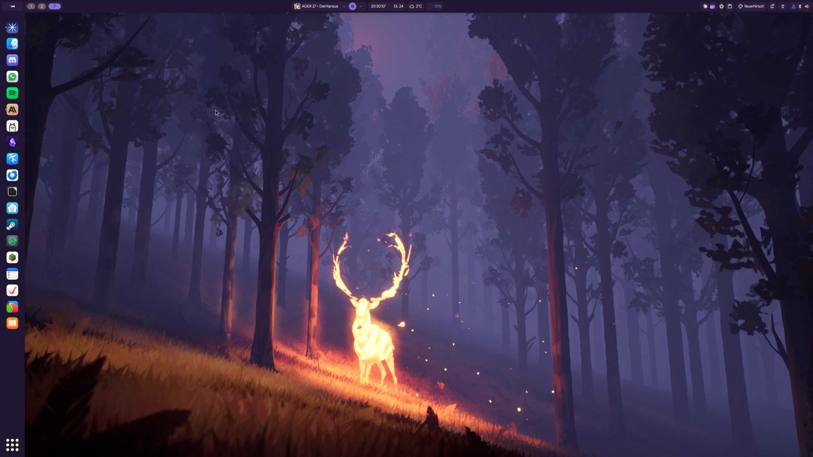</td>
    <td></td>
  </tr>
  <tr>
    <td>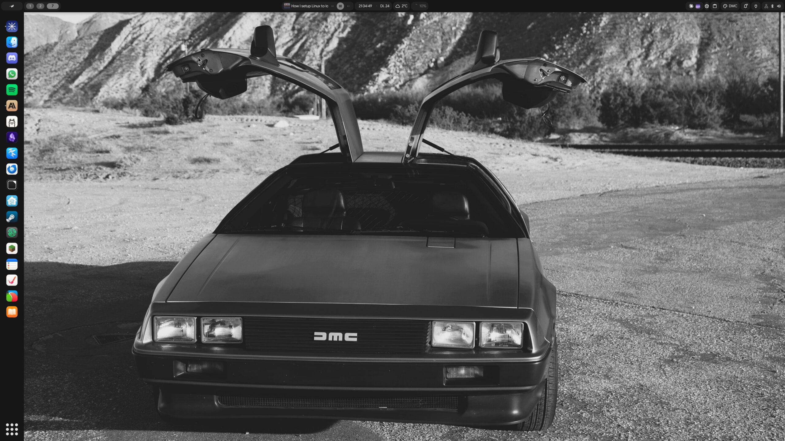</td>
    <td>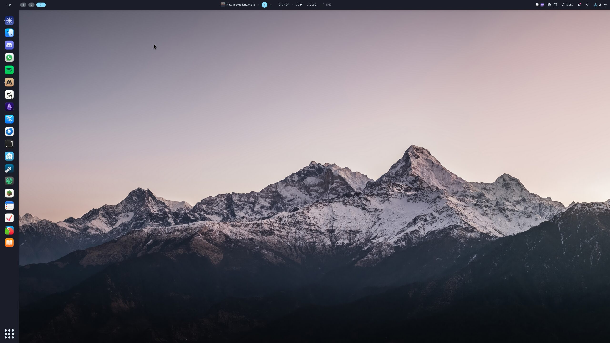</td>
  </tr>
  <tr>
    <td>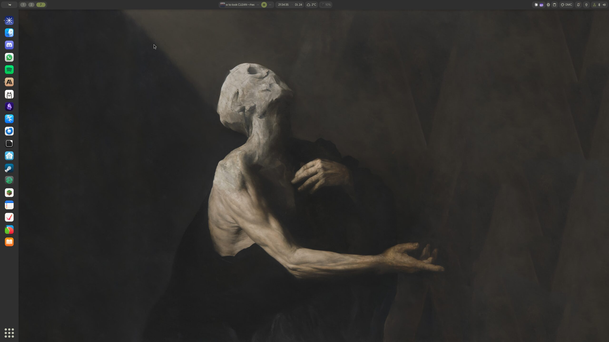</td>
    <td></td>
  </tr>
</table>

> **Full documentation: the [glut wiki](https://github.com/FL4REE/glut/wiki)** explains every feature, shortcut and setting.

## What this is

*Glut* is German for embers. It is my daily desktop, published the way it actually runs, not a cleaned-up showcase.

- **Exact, not approximate.** The repo is a mirror of the live machine. Every night a timer copies the real configs and the real package list back into this repo and pushes them. What you clone is what I'm running today.
- **One command.** `install.sh` takes a fresh CachyOS install to this desktop: packages, configs, shell plugins, 136 themes, login screen, services, tools.
- **Hardware-agnostic.** GPU drivers and microcode are not copied from my machine. CachyOS' `chwd` picks the right ones for yours.
- **Wallpaper is the theme.** Pick a wallpaper and the whole desktop follows it: shell, window borders, terminal, prompt, editor, even the Pokémon that greets you in every new terminal.
- **Offline where it counts.** Speech-to-text runs locally on the GPU, nothing leaves the machine.

## Features

<table>
  <tr>
    <td width="50%">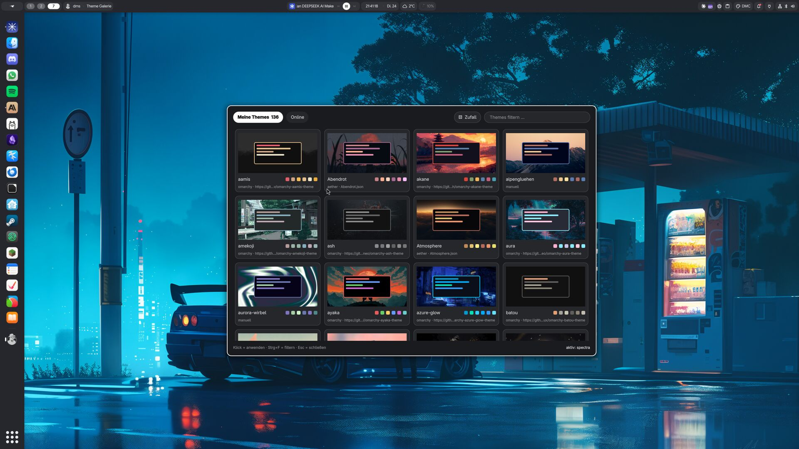</td>
    <td width="50%">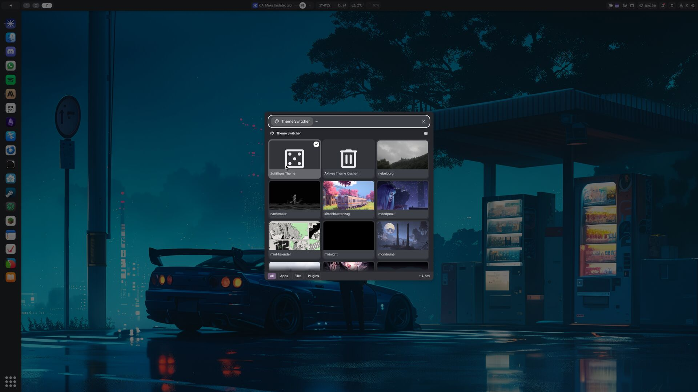</td>
  </tr>
  <tr>
    <td><b>Theme gallery.</b> All 136 themes as live previews with their palettes. Click to apply, <i>Zufall</i> for a random one, <i>Online</i> to import more from aether, iTerm2 or Omarchy.</td>
    <td><b>Themes in the launcher.</b> <code>SUPER + Space</code>, type <code>~</code>, pick a wallpaper. Also on <code>SUPER + ALT + T</code>, or <code>SUPER + ALT + N</code> for the next one.</td>
  </tr>
  <tr>
    <td>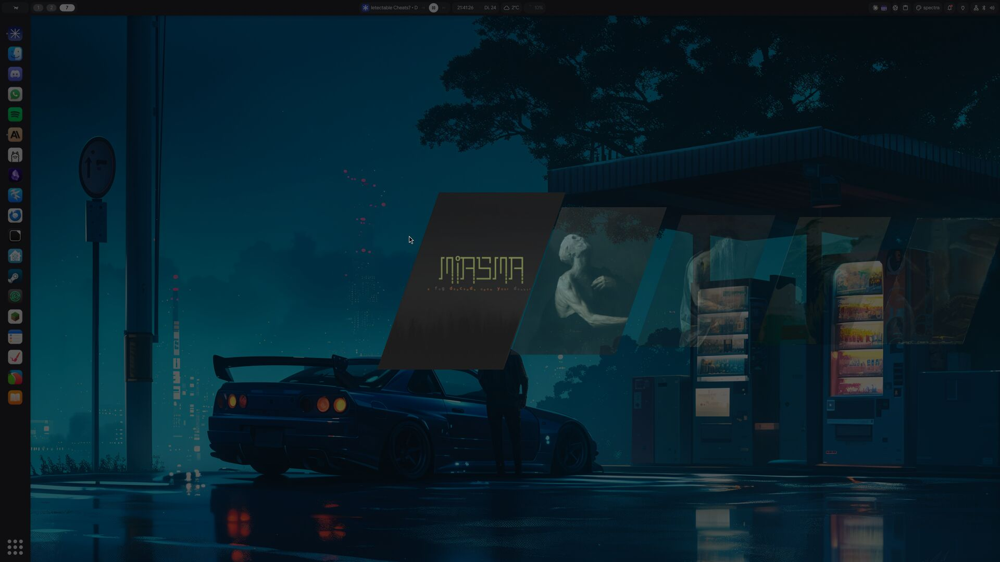</td>
    <td></td>
  </tr>
  <tr>
    <td><b>Wallpaper carousel.</b> <code>SUPER + ALT + W</code> flips through every wallpaper full screen.</td>
    <td><b>A Pokémon that matches.</b> Every new shell greets you with pokefetch. The Pokémon is picked from the 40 whose sprite colors are closest to the current theme.</td>
  </tr>
  <tr>
    <td>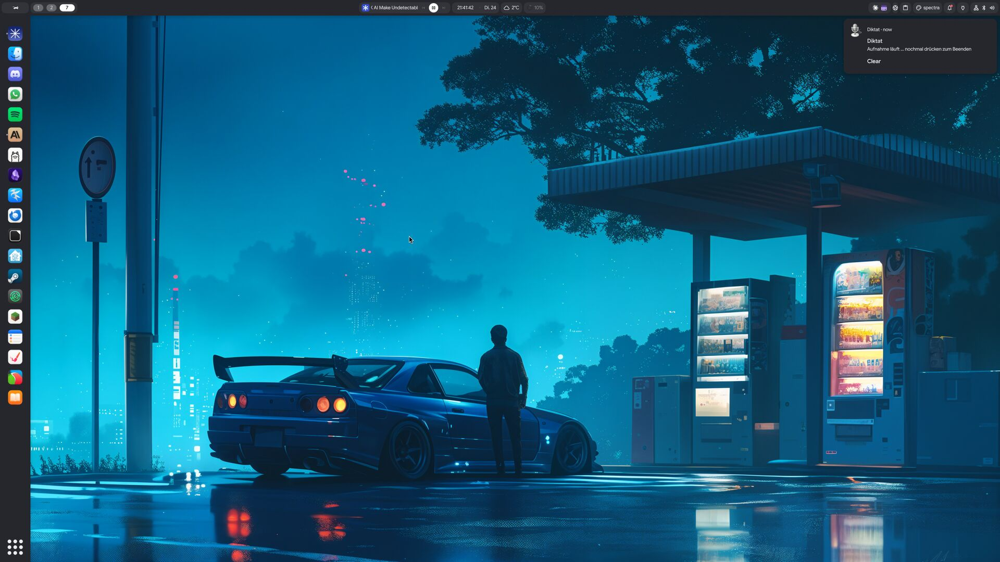</td>
    <td>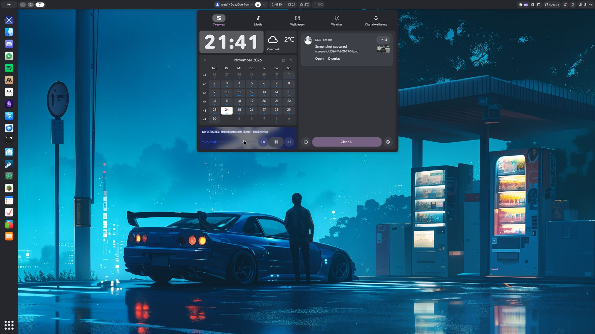</td>
  </tr>
  <tr>
    <td><b>Dictation, offline.</b> <code>SUPER + ALT + D</code>, speak, press again. Whisper transcribes on the GPU and types the text into the focused window.</td>
    <td><b>Dashboard.</b> Clock, calendar, weather, media controls and notifications in one panel, on <code>SUPER + Y</code>.</td>
  </tr>
  <tr>
    <td>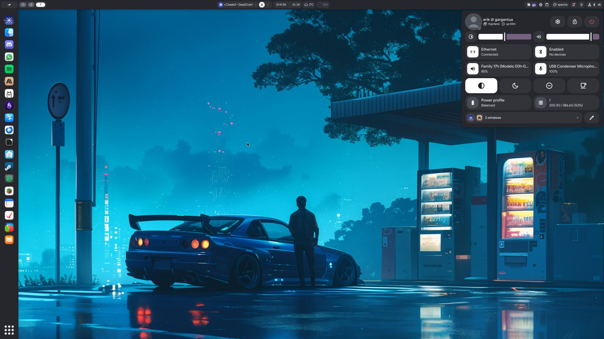</td>
    <td>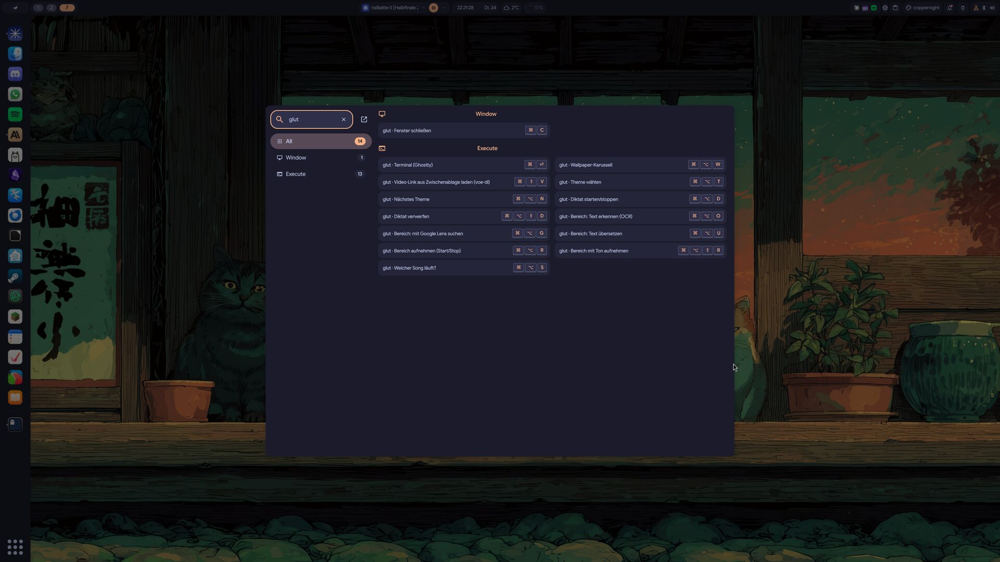</td>
  </tr>
  <tr>
    <td><b>Control center.</b> Brightness, volume, network, Bluetooth, audio devices, night mode, power profile, disk usage.</td>
    <td><b>Every keybind, searchable.</b> <code>SUPER + ß</code> or <code>SUPER + F1</code> lists all binds by category; type <code>glut</code> to see only the ones this setup adds. Click one to run it.</td>
  </tr>
  <tr>
    <td>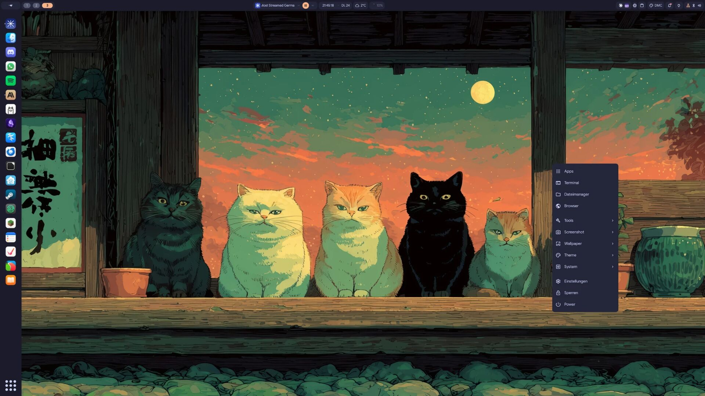</td>
    <td>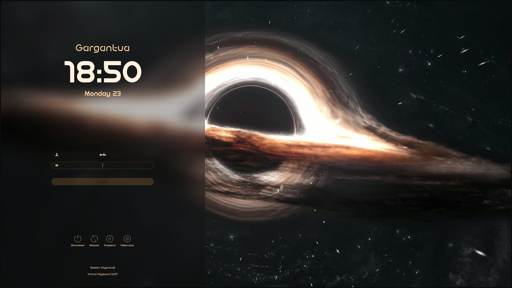</td>
  </tr>
  <tr>
    <td><b>Right-click the desktop.</b> A Windows-style context menu: apps, terminal, files, browser, plus submenus for tools, screenshots, wallpaper, themes and system (<a href="projects/DesktopContextMenu">DesktopContextMenu</a>).</td>
    <td><b>Login screen.</b> SDDM with an animated Gargantua black hole (<a href="https://github.com/FL4REE/sddm-gargantua">sddm-gargantua</a>). The accretion disk moves.</td>
  </tr>
  <tr>
    <td colspan="2">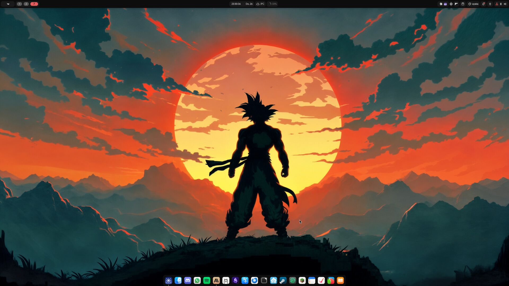</td>
  </tr>
  <tr>
    <td colspan="2"><b>Bar or dock.</b> <code>SUPER + ALT + B</code> swaps the app bar on the left for a centered dock at the bottom, macOS style, with a gentle 120 % magnification on hover. Pinned apps move along both ways.</td>
  </tr>
  <tr>
    <td colspan="2">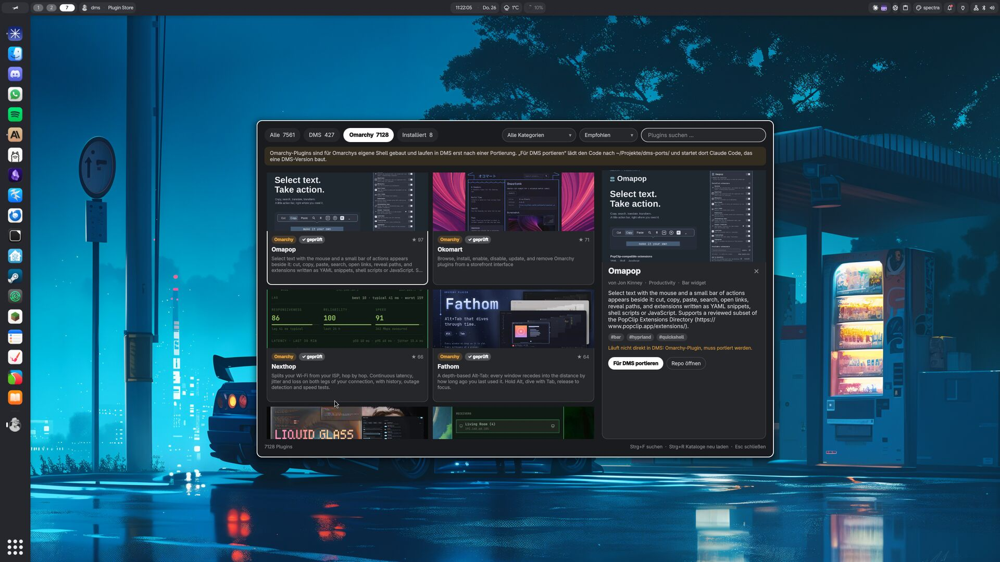</td>
  </tr>
  <tr>
    <td colspan="2"><b>Plugin Store.</b> <code>SUPER + ALT + P</code>: 427 DMS plugins to install with one click and 7,000+ Omarchy plugins to browse. Omarchy plugins are built for a different shell, so <i>Für DMS portieren</i> clones one and hands it to Claude Code, which rebuilds it as a DMS plugin.</td>
  </tr>
</table>

## Install

On a fresh [CachyOS](https://cachyos.org) install (or Arch with the CachyOS repos), as your normal user:

```sh
sudo pacman -S --needed git github-cli
git clone https://github.com/FL4REE/glut ~/glut
~/glut/install.sh
```

Reboot, pick Hyprland on the login screen, done. Re-running `install.sh` is safe; anything it would replace is moved to `~/.glut-backup-<date>/` first.

| Option | Effect |
| :--- | :--- |
| `GLUT_SKIP_WALLPAPERS=1` | Skip the wallpaper pack (~500 MB). Themes still work, without images. |
| `GLUT_SKIP_WHISPER=1` | Skip the speech-to-text model (~550 MB). |
| `GLUT_SKIP_SDDM=1` | Keep your current login screen. |
| `GLUT_PRIVATE_REPO=you/your-private` | Also clone and run your own private overlay (see below). |

<details>
<summary><b>What <code>install.sh</code> does, step by step</b></summary>

| Stage | What happens |
| :--- | :--- |
| 1. Packages | Full `pacman -Syu`, builds `paru` from source (CachyOS' libalpm breaks `paru-bin`), installs [`pacman.txt`](packages/pacman.txt), [`aur.txt`](packages/aur.txt), [`flatpak.txt`](packages/flatpak.txt), then `chwd -a` for drivers. |
| 2. Configs | Symlinks `config/*` into `~/.config`, so a `git pull` updates the desktop in place. Rewrites absolute paths for your username. |
| 3. Shell plugins | Links the plugins in [`projects/`](projects), restores the third-party ones from [`plugins.lock.json`](config/dms/plugins.lock.json) at their pinned commits. |
| 4. Themes | Installs `themectl`, pokefetch, the 136 palettes in [`themes/`](themes) and the wallpaper pack from the [releases](https://github.com/FL4REE/glut/releases), then applies the current theme. |
| 5. Login screen | SDDM with [sddm-astronaut-theme](https://github.com/Keyitdev/sddm-astronaut-theme) and the animated [Gargantua](https://github.com/FL4REE/sddm-gargantua) variant. |
| 6. Services | DMS, calendar daemon, session target, the nightly sync timer (owner only). |
| 7. Speech-to-text | Downloads the Whisper `large-v3-turbo` model. |
| 8. Private overlay | Clones and runs a private repo if your `gh` login can see it. |

</details>

## Keybinds

Keyboard first. `SUPER + ß` (the `?` key on a German keyboard) or `SUPER + F1` shows every bind on screen; type `glut` there to filter to the custom ones below.

| Keys | Action |
| :--- | :--- |
| `SUPER + Space` | Launcher (type `~` to search themes) |
| `SUPER + Return` | Terminal (Ghostty) |
| `SUPER + ALT + D` | Dictate: speak, press again, the text is typed into the focused window |
| `SUPER + ALT + O` | Select an area, copy the text in it (OCR) |
| `SUPER + ALT + G` | Select an area, search it with Google Lens |
| `SUPER + ALT + U` | Select an area, translate the text in it |
| `SUPER + ALT + R` | Record an area (again to stop, `+ SHIFT` with sound) |
| `SUPER + ALT + S` | Which song is playing? |
| `SUPER + ALT + P` | Plugin Store: browse and install DMS and Omarchy plugins |
| `SUPER + ALT + B` | Switch the left app bar to a macOS-style dock at the bottom and back |
| `SUPER + ALT + T` | Pick a theme |
| `SUPER + ALT + N` | Next theme |
| `SUPER + ALT + W` | Wallpaper carousel |
| `SUPER + V` | Clipboard history |
| `SUPER + Tab` | Overview of all workspaces |
| `SUPER + N` | Notifications |
| `SUPER + X` | Power menu |
| `SUPER + ALT + L` | Lock |
| `SUPER + C` | Close window |
| `SUPER + F` / `SUPER + SHIFT + F` | Maximize / fullscreen |
| `SUPER + SHIFT + T` | Toggle floating |
| `SUPER + H J K L` or arrows | Move focus (`+ SHIFT` moves the window) |
| `SUPER + 1…9` | Workspace (`+ SHIFT` sends the window there) |

## Custom tooling

Small tools written for this desktop. They all live in [`bin/`](bin) and are linked into `~/.local/bin`. Their messages are in German.

| Tool | What it does |
| :--- | :--- |
| [`themectl`](https://github.com/FL4REE/theme-switcher) | The theme engine. Turns a wallpaper into a full palette and applies it in one go: shell and window borders (via matugen), wallpaper, Starship, Neovim, icon theme and the terminal Pokémon. Imports themes from aether, iTerm2 and Omarchy. Comes with a theme gallery and a launcher plugin. |
| [`diktat`](bin/diktat) | Offline speech-to-text on a hotkey. Records with PipeWire, transcribes with whisper.cpp on the GPU, copies the text and types it into the focused window. |
| [`app`](bin/app) | `app yt`, `app gh`, `app dc`: short names for websites (opened as their own windows, no tabs) and programs. Fuzzy picker without arguments, Fish completion. Edit [`config/app/apps.conf`](config/app/apps.conf). |
| [pokefetch](https://github.com/Yanzz231/PokeFetch) + [`pokefetch-color`](bin/pokefetch-color) | Every new Fish shell opens with a Pokémon fetch, color-matched to the theme: `themectl` reads the real sprite colors of all Pokémon once and picks the 40 closest to the theme's accent, so a green theme gets green Pokémon. `pokefetch-color blau` picks by color class by hand, `--list` shows how many there are per color. |
| [`bereich`](bin/bereich) | Area tools: drag a rectangle, then copy its text (Tesseract OCR, German + English), search it with Google Lens, translate it, or record it as video on the GPU (`gpu-screen-recorder`, optional system sound). The Lens image goes straight to Google, not through a public file host. |
| [`welcher-song`](bin/welcher-song) | "Which song is this?" Listens to what your speakers are playing (not the mic) and names it via Shazam (`songrec`). Title and artist land in a notification and the clipboard. |
| [`plugin-store`](bin/plugin-store) | One window for two plugin catalogs: the 427 [DMS plugins](https://github.com/duxlabs-dev/dux-plugin-registry) (install, remove, switch on/off with one click) and the 7,000+ [Omarchy plugins](https://plugins.omarchy.org/). Omarchy plugins are written for Omarchy's own shell and do not run in DMS as-is, so the store offers to port them: it clones the plugin and starts a Claude Code session that rebuilds it as a DMS plugin. Installed plugins are pinned in `plugins.lock.json`, which `install.sh` restores. |
| [`dockmodus`](bin/dockmodus) | Toggles between the app bar on the left and a centered DMS dock at the bottom, like macOS. Pinned apps move along, so both always show the same apps. |
| [`livewallpaper`](bin/livewallpaper) | Animated Wallpaper Engine backgrounds via `linux-wallpaperengine`, with a picker. |
| [`confsync`](bin/confsync) | Mirrors the live configs into this repo ([`manifest.txt`](config/manifest.txt)). Refuses to commit anything that looks like an API key or token. |
| [`pkgsync`](bin/pkgsync) | Keeps the package lists in step with what is really installed. New packages are appended, nothing is ever removed silently, drivers are filtered out via [`ignore.txt`](packages/ignore.txt). |

### Shell plugins

| Plugin | What it does |
| :--- | :--- |
| [DesktopContextMenu](projects/DesktopContextMenu) | Windows-style right-click menu on the desktop: apps, updates, power, screenshot. |
| [FussballTicker](projects/FussballTicker) | Live scores in the bar and goal notifications for Hansa Rostock, BVB, the Bundesliga and Germany (needs a free api-football key). |
| [MediaFlyouts](projects/MediaFlyouts) | FluentFlyout-style pop-ups for music and lock keys, visible over fullscreen apps. |
| [RunCat](projects/RunCat) | The running cat: CPU load as animation speed. |
| ThemeSwitcher / ThemeGallery | From [theme-switcher](https://github.com/FL4REE/theme-switcher): themes in the launcher and a visual gallery. |

## Stack

| Layer | Choice |
| :--- | :--- |
| Distro | CachyOS (Arch, x86-64-v3 optimized) |
| Compositor | Hyprland 0.57 with the new Lua config |
| Shell / bar / launcher | DankMaterialShell (Quickshell), via [dux-shell](https://github.com/duxlabs-dev/dux-shell) |
| Login | SDDM + sddm-astronaut-theme, Gargantua variant |
| Terminal | Ghostty |
| Shell | Fish + Starship |
| Editor | Neovim (AstroNvim) |
| Colors | themectl + matugen |
| Audio | PipeWire |
| Speech-to-text | whisper.cpp (CUDA) |

## How the sync works

```
 live desktop ──(nightly timer)──▶ confsync ──▶ config/, themes/, projects/
                                   pkgsync  ──▶ packages/*.txt
                                      │
                         secret check, commit, pull --rebase, push
                                      ▼
                                github.com/FL4REE/glut
                                      │
                      git clone && ./install.sh  (any new machine)
```

On the machine I work on, configs are real folders and get copied in. On every machine set up with `install.sh`, they are symlinks into the clone, so edits land in the repo directly.

## Private overlay

Things that only make sense for me (editor and AI tool settings, my notes vault) live in a separate private repository. `install.sh` runs it at the end if the logged-in `gh` user can see it, and skips it silently otherwise. To use the same mechanism for your own private bits, point `GLUT_PRIVATE_REPO` at a repo with an `install.sh`.

## Layout

```
glut/
├── install.sh        one-shot installer
├── apps/             Quickshell windows (Plugin Store)
├── bin/              custom tools (linked into ~/.local/bin)
├── config/           ~/.config mirror + manifest/exclude for confsync
├── home/             files that live directly in ~
├── packages/         pacman, AUR and Flatpak lists, ignore patterns
├── projects/         own shell plugins
├── themes/           136 palettes (wallpapers come from the releases)
└── systemd/          user units: session target, sync timer, calendar
```

## Credits

- [DankMaterialShell](https://github.com/AvengeMedia/DankMaterialShell) / [dux-shell](https://github.com/duxlabs-dev/dux-shell): the shell everything sits in.
- [wallpaperCarousel](https://github.com/motor-dev/wallpaperCarousel) (MIT) and [dms-claudecode](https://github.com/titeya/dms-claudecode) (MIT): shell plugins, installed from upstream.
- [sddm-astronaut-theme](https://github.com/Keyitdev/sddm-astronaut-theme) (GPL-3.0): the login screen base.
- [runcat-text](https://github.com/bzglve/runcat-text) (BSD-2-Clause): the cat font in RunCat, [license](projects/RunCat/LICENSE-runcat.ttf).
- [PokeFetch](https://github.com/Yanzz231/PokeFetch) and the sprites from [pokemon-colorscripts](https://gitlab.com/phoneybadger/pokemon-colorscripts): the terminal Pokémon.
- [whisper.cpp](https://github.com/ggml-org/whisper.cpp), [aether](https://github.com/bjarneo/aether), [matugen](https://github.com/InioX/matugen), [AstroNvim](https://github.com/AstroNvim/AstroNvim).
- Inspired by [osyx](https://github.com/rccyx/osyx).
- Wallpapers belong to their respective artists.

## License

[MIT](./LICENSE), except for third-party files, which keep their own licenses.
